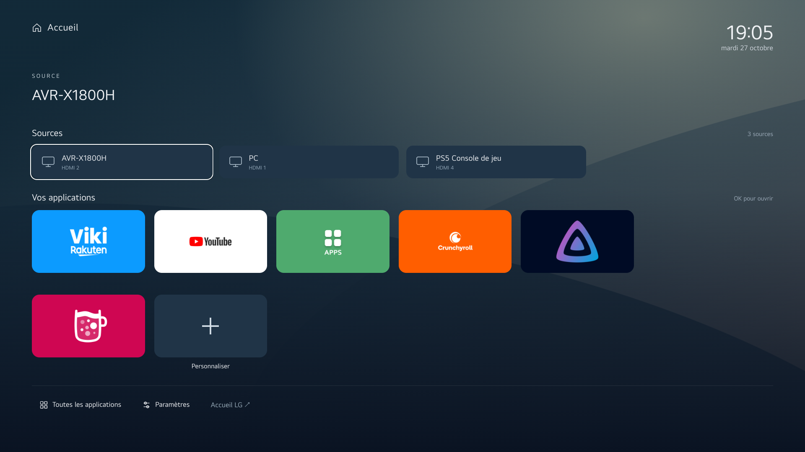
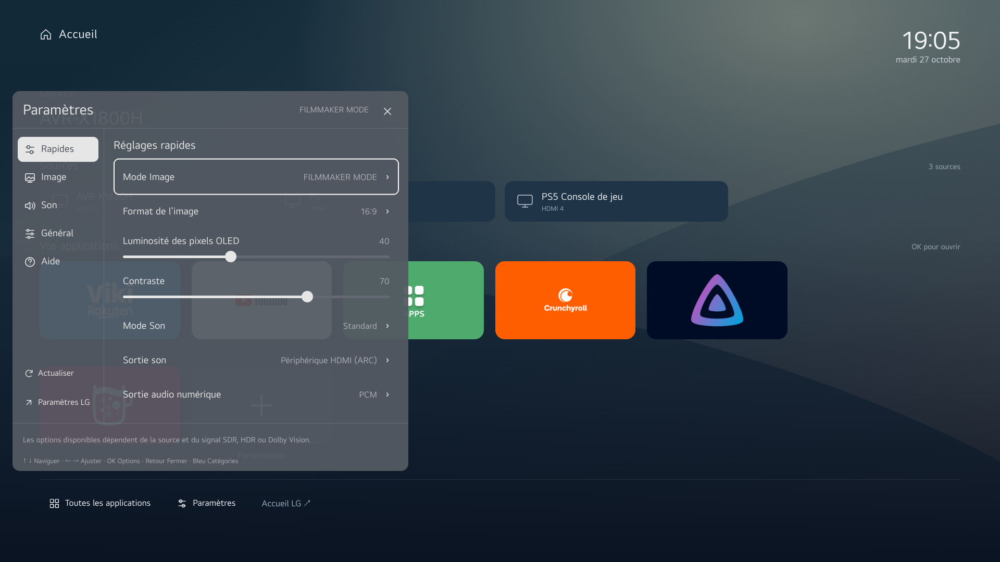

# Clean My LG TV

A lightweight, local home screen and quick settings panel for a rooted LG webOS TV, with reversible startup hooks to reduce unwanted background services. The TV interface is currently in French. The LG home screen and full settings remain accessible.

This was developed and tested on an LG OLED65CS6LA running webOS 25, SDK 10.3.1-3006 and firmware 33.31.68. Other models and firmware may differ. Root access, Homebrew Channel, SSH and LG Input Hook 1.5.0 are prerequisites; this project does not root the television or install Input Hook.

## What is included

- **Home** (`org.local.cleanlauncher` 0.2.4): local clock, HDMI inputs, up to six favorites, app drawer and a customizable 3–6 column grid. The last tile opens customization. Yellow also opens customization. OK launches normally; there is no long-press action.
- **Quick settings** (`org.local.quicksettings` 0.3.5): local controls and shortcuts to the full LG settings. Controls depend on the active hardware, input and picture mode.
- **Startup and cleanup**: Homebrew hooks for key bindings, Home routing and reversible service exclusions and temporary bind mounts. No firmware libraries are replaced.
- **Shared motion**: one focus and scrolling implementation bundled into both apps.

The LG Store, Viki, YouTube, Crunchyroll, button-activated voice search, Chromecast, AirPlay and Miracast were retained on the test TV. Input labels are local preferences, not requirements. Animated HDMI preview is not implemented.

## On the TV

The following are captures of the installed apps on the test TV. Available sources, apps and settings depend on the device.





## Build and test

Install Node.js and Python 3, then from the repository root:

```sh
npm ci --prefix quick-settings/.tools
node --test quick-settings/tests.cjs launcher/test-launcher.cjs shared/test-tv-motion.cjs launcher/native-home/test-home.js launcher/native-home/test-idle.js
node build.cjs
```

The build creates IPKs in `quick-settings/` and `launcher/`. It bundles `shared/tv-motion.js` into both applications; package `launcher/.build/app`, never `launcher/app` directly. Generated output, dependencies and private TV backups are excluded from Git.

The locked development toolchain reported six npm audit findings on 27 October 2026 (one moderate, four high, one critical). Review `npm audit` before using or updating the build tooling. These development dependencies are not shipped as TV application dependencies.

## Install, operate and undo

See [installation and rollback](docs/installation.md) for explicit commands, startup behavior and recovery. The scripts target paths and service names verified on the test TV; inspect them and retain your own backups before applying them elsewhere. A system reboot was tested with Home and the PC input restored. Full power loss and firmware updates were not tested; root and Homebrew persistence across updates is not guaranteed.

Favorites are stored in the launcher's local storage. Removing its data removes those preferences. Screens and settings differ between devices; the original LG interfaces remain the fallback.

## Repository map

`launcher/` contains the Home app, remapping and Home routing; `quick-settings/` contains the panel, its Luna service and remapping; `shared/` contains the common focus and scrolling code. `debloat-services.sh` and `debloat-extra.sh` are the two optional cleanup hooks. The scripts were compared to the installed TV versions; the two English message translations in `quick-settings/control.js` and `quick-settings/rollback.sh` do not change their behavior.
